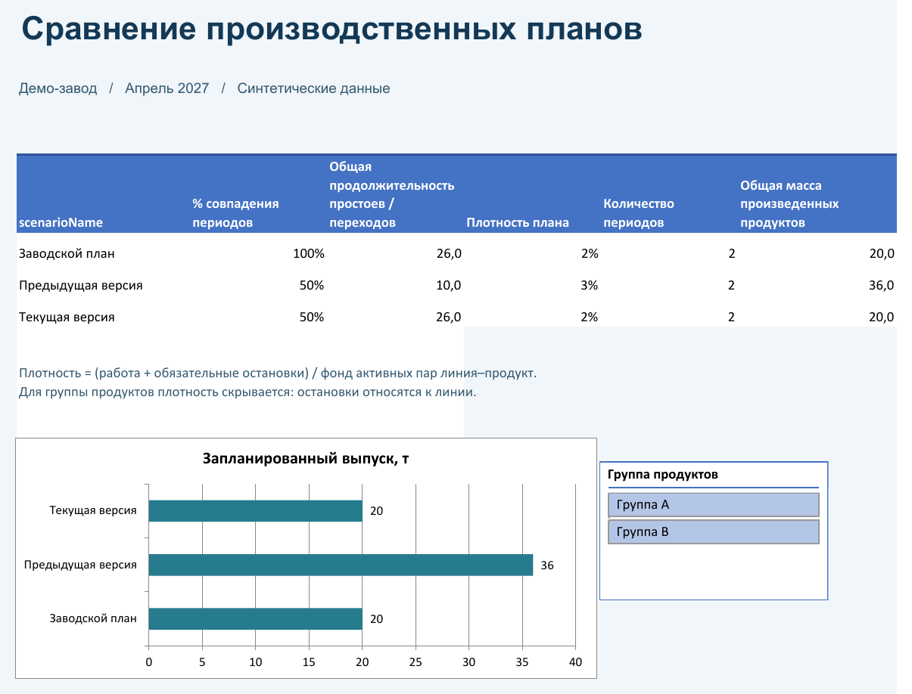

# Production Plan Comparison

Excel-дашборд для сравнения заводского производственного плана с текущей и предыдущей версиями плана системы. На примере одного месяца можно увидеть, какие заказы попали в нужную дату, как распределился выпуск и почему вариант с большей массой может оказаться перегруженным.

**Автор проекта — MrKostas.** В этом кейсе я подготовил Python ETL для разных Excel-форм, спроектировал модель Power Pivot, реализовал расчёты на Power Query M и DAX и собрал отчёт для сравнения сценариев. Все площадки, продукты, нормы и значения в демонстрации синтетические. Проект предназначен для личного портфолио.



## Открыть демонстрацию

1. Скачайте или клонируйте весь репозиторий. Откройте [Production Plan Comparison.xlsx](dashboard/Production%20Plan%20Comparison.xlsx) в настольном Excel для Windows с Power Pivot.
2. На листе «Обзор» сравните три сценария и попробуйте срез группы продуктов. На листе «Анализ» выберите один сценарий и линию. На листе «ИКП» изучите вклады в итоговый балл и причину блокировки оценки.
3. Для повторного обновления укажите полный путь к каталогу `demo` в ячейке B7 листа «Настройки» и выберите **Данные → Обновить всё**. В репозитории есть и исходные синтетические формы, и плоские таблицы после ETL.

[Детализация по датам и линиям](docs/assets/analysis.png) · [Проверка ИКП в Excel](docs/assets/quality-index.png) · [Модель Power Pivot](docs/assets/power-pivot-model.png)

## Как устроен расчёт

**Excel-формы → Python / pandas → плоские таблицы → Power Query → Power Pivot / DAX → сводные и срезы.**

Python разворачивает дневные колонки заводского графика и заказов, восстанавливает дату из событий экспорта системы, связывает строки со сценарием и линией, проверяет месяц и ключи справочников. Power Query агрегирует выпуск до зерна «сценарий × линия × продукт × день», присоединяет нормы, строит календарь, определяет серии и готовит данные об остановках. DAX считает показатели в контексте фильтров. [Схема модели и связи](docs/data-model.md).

| Метрика | Как читать |
|---|---|
| Совпадение дат | Доля уникальных пар «дата × продукт» в заказах, по которым в эту дату запланирован положительный выпуск |
| Расчётная недозагрузка | Неиспользованные нормативные часы по дневной массе. При пропуске нормы часовой результат пуст |
| Плотность плана | Расчётные рабочие часы плюс обязательные остановки, делённые на месячный фонд активных пар «линия × продукт». Нужна подтверждённая полнота остановок |
| Производственные серии | Уникальные серии продукта на линии. Пробел в календаре сохраняет серию. Активный день линии без этого продукта завершает её |
| Масса | Суммарный положительный выпуск в тоннах |

В текущем сценарии две записи выпуска продукта A с массой 4 и 6 т складываются в 10 т за день. Норма применяется к дневной массе, поэтому обе записи дают одну оценку загрузки по паре «линия × продукт» за день.

### Индекс качества плана

ИКП сравнивает альтернативный сценарий с заводским планом (100 пунктов). Вклады в оценку дают уплотнение занятых линия-дней, совпадение дат заказов и число серий с весами 60%, 25% и 15%. Отклонение месячного объёма по продуктам уменьшает балл, а выход за допуск ограничивает результат уровнем эталона. Суточная перегрузка оставляет ИКП пустым. Проверка мощности использует необрезанные часы выпуска и обязательные остановки в разрезе «линия × день».

В примере текущий план сохраняет ассортимент и объём, использует один линия-день вместо двух и теряет одно совпадение даты. Вклад уплотнения составляет +30, дат −12,5, итог **117,5**. Предыдущий план даёт 36 т, но в один день использует 37 ч при фонде 23 ч. У него отображается статус перегрузки.

Модель загружает один календарный месяц и одну вымышленную площадку. Заказы заданы на зерне «дата × продукт», поэтому совпадение дат по отдельной линии не интерпретируется как её выполнение заказов. Проверка ИКП охватывает суточную мощность. Сырьевые ограничения, внутрисуточные пересечения и порядок переналадок требуют отдельных проверок.

## Воспроизвести данные

Из корня проекта с Python 3.12:

```powershell
python -m pip install -r requirements.txt
python generate_demo.py
python packaging_data_pipeline.py
python -X utf8 ikp_validation.py --month 2027-04
python -m unittest discover -s tests
```

`generate_demo.py` перезаписывает демонстрационные входы. ETL записывает два файла в `demo/processed/`. `ikp_validation.py` рассчитывает индекс независимо от Excel и выводит JSON с баллами, статусами, вкладами и хешами нормализованных входов.

[Контрольные значения и сценарии проверки](docs/validation.md)

## English summary

This portfolio project compares a factory production plan with two scheduling-system versions. A Python ETL normalizes synthetic Excel inputs. Power Query builds the model tables, and Power Pivot / DAX drives the interactive reports. An independent Python implementation checks the research-stage plan-quality score, including the daily-capacity gate.
