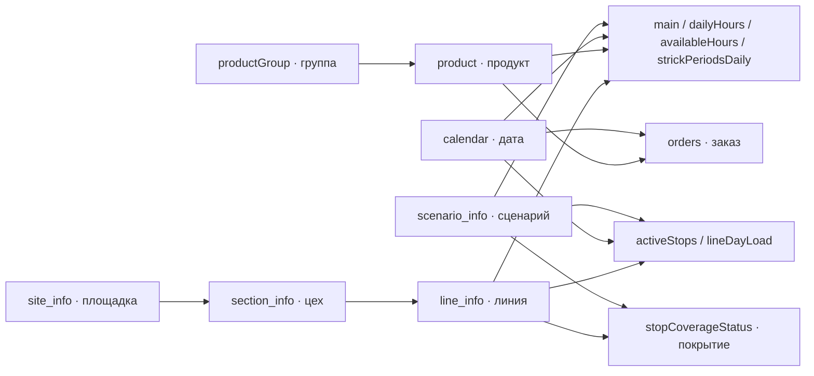

# Модель Power Pivot

Фильтр идёт от стороны «один» к стороне «многие». План и заказы связаны через общие измерения календаря и продукта.

| Таблица или набор | Зерно | Ключи связей в таблице |
|---|---|---|
| `site_info`, `section_info`, `line_info` | Площадка, цех, линия | `siteKey`, `sectionKey`, `lineKey` |
| `productGroup`, `product` | Группа, продукт | `product.productGroup → productGroup.name` |
| `scenario_info`, `calendar` | Сценарий, дата | `scenarioCode`, `date` |
| `main` | Строка плана | `scenarioKey → scenario_info.scenarioCode`, `lineKey`, `material → product.name`, `date` |
| `strickPeriodsDaily`, `dailyHours` | Сценарий × линия × продукт × день с выпуском | Как у `main` |
| `availableHours` | Каждая дата месяца для каждой активной пары линия × продукт в сценарии | Как у `main` |
| `orders` | Строка заказа | `date`, `material → product.name` |
| `activeStops` | Событие остановки на активной линии | `lineKey`, `scenarioKey`, `date` |
| `stopCoverageStatus` | Активная линия × сценарий за месяц | `lineKey`, `scenarioKey` |
| `lineDayLoad` | Зарегистрированная линия × дата × сценарий | `lineKey`, `scenarioKey`, `date` |

Стрелки отражают физические связи Power Pivot. Запросы `performance_info`, `mandatory_stops`, `stop_coverage` и `ikpComparison` готовят нормы, события, полноту и контракт сравнения для производных таблиц. `DemoRoot` читает именованную ячейку `DemoPath`, а `ReadSheet` загружает листы из относительных путей внутри `demo`.

Текстовые определения находятся в [model](../model). Меры DAX хранятся в таблице `main`. `strickPeriodsDaily` сохраняет историческое имя запроса.
